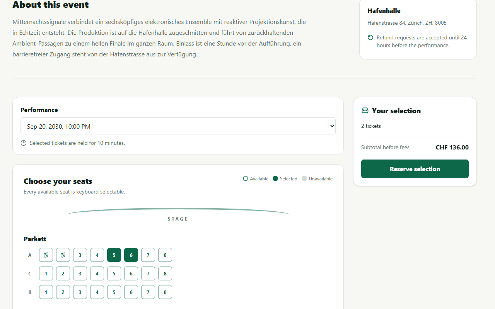
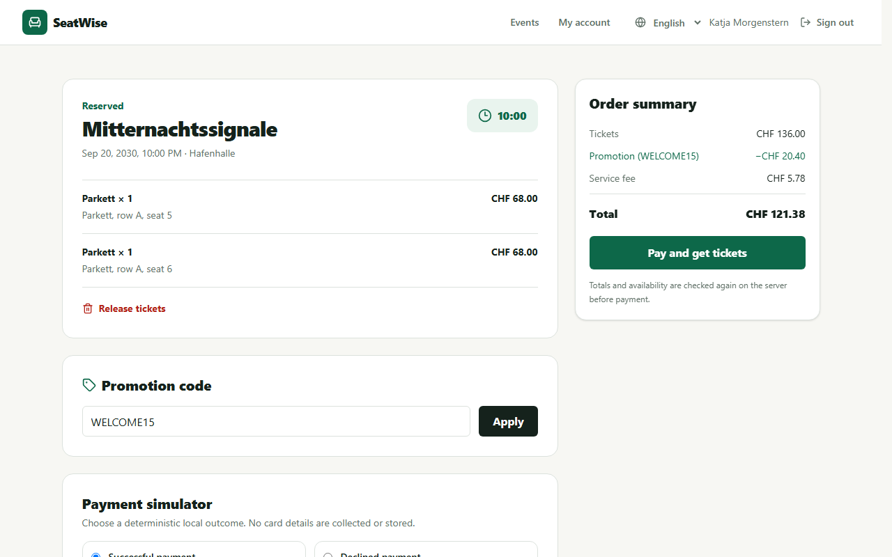
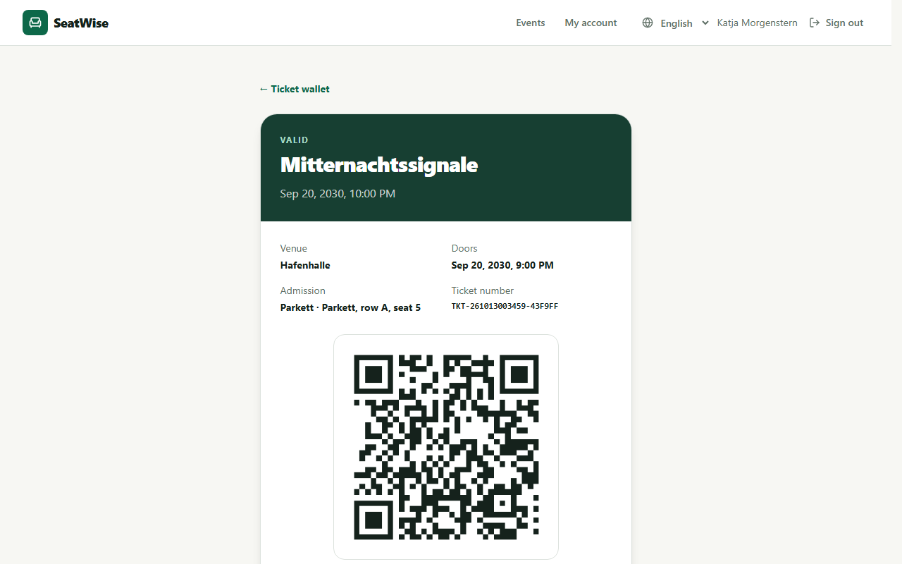
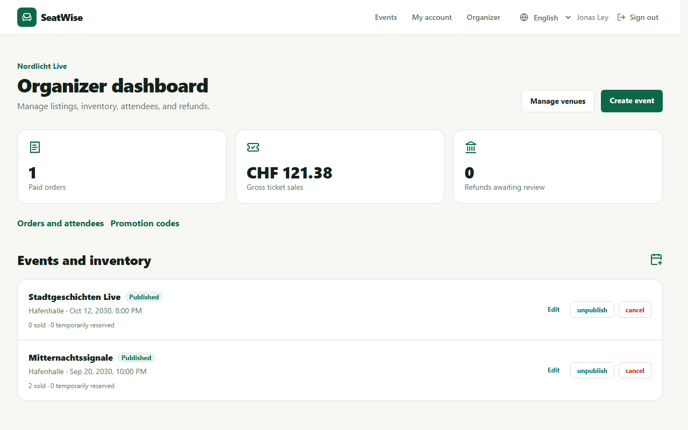

# SeatWise

[](https://github.com/RetoSchneider/SeatWise/actions/workflows/quality.yml)

SeatWise is an event-ticketing web application and a showcase for how I test one. Customers reserve seats and pay through a payment simulator, organizers manage their events and refunds, and administrators moderate the platform. A Playwright suite runs API, browser and accessibility tests against the production build and a real PostgreSQL database.

**[Open the latest test report](https://retoschneider.github.io/SeatWise/)**: the Playwright HTML report from the last CI run on `master`.

<p>
  
  
  
  
</p>

## What the tests cover

| Risk                       | How it is tested                                                                                      |
| -------------------------- | ----------------------------------------------------------------------------------------------------- |
| Overselling                | Two customers reserve the same seat at once: one gets `201`, the other `409`, and the database agrees |
| Duplicate charges          | Idempotency-key replay, a reused key with different input, and a retry after a lost checkout response |
| Payment failures           | Declined, timed-out and transient payments, then a successful retry                                   |
| Unauthorized access        | Anonymous requests, wrong roles, other customers' orders, demoted sessions and suspended organizers   |
| Refund and promotion races | Concurrent requests checked against stored refunds, tickets, totals and redemption counts             |
| Accessibility              | axe-core scans 23 customer, organizer and admin pages for WCAG 2.2 A and AA issues                    |
| Browser behavior           | Keyboard seat selection, checkout, QR tickets and language switching in Chromium, Firefox and WebKit  |

Every test creates its own users and events and deletes them afterwards. The [testing guide](docs/testing.md) explains the full strategy, and [defects found](docs/defects.md) lists the bugs the tests and reviews caught.

## Run it

You need Node.js 22.14 or newer, pnpm 10.18.3 and Docker.

```bash
cp .env.example .env
pnpm install --frozen-lockfile
pnpm db:generate
```

**Demo:** start the services, load the demo data and open http://localhost:3000.

```bash
docker compose up -d --wait
pnpm db:deploy
pnpm db:seed
pnpm dev
```

Sign in as `customer@seatwise.local`, `organizer@seatwise.local` or `admin@seatwise.local` with the password `SeatWise!2026`. The [demo guide](docs/demo.md) walks through a booking.

**Tests:** these use their own database and port, so they can run next to the demo.

```bash
pnpm test:db:up
pnpm test:db:prepare
pnpm exec playwright install chromium firefox webkit
pnpm check
pnpm test:e2e
pnpm test:report
```

`pnpm check` runs formatting, ESLint, TypeScript and the Vitest unit tests. `pnpm test:e2e` builds the app and runs every Playwright project.

## Documentation

- [Testing guide](docs/testing.md): strategy, test data, debugging and adding tests
- [Defects found](docs/defects.md): bugs found by the tests and reviews, and how they were fixed
- [Demo guide](docs/demo.md): accounts, booking walkthrough and troubleshooting
- [API](docs/api.md), [architecture](docs/architecture.md), [operations and security](docs/operations.md) and [decision records](docs/adr)

## Tech stack

- **Application:** Next.js 16, React 19, TypeScript, Better Auth
- **Data:** Prisma 7, PostgreSQL 18, Mailpit for local email
- **Testing:** Playwright, Vitest, axe-core
- **CI:** GitHub Actions, with the test report published to GitHub Pages

## License

[MIT](LICENSE)
